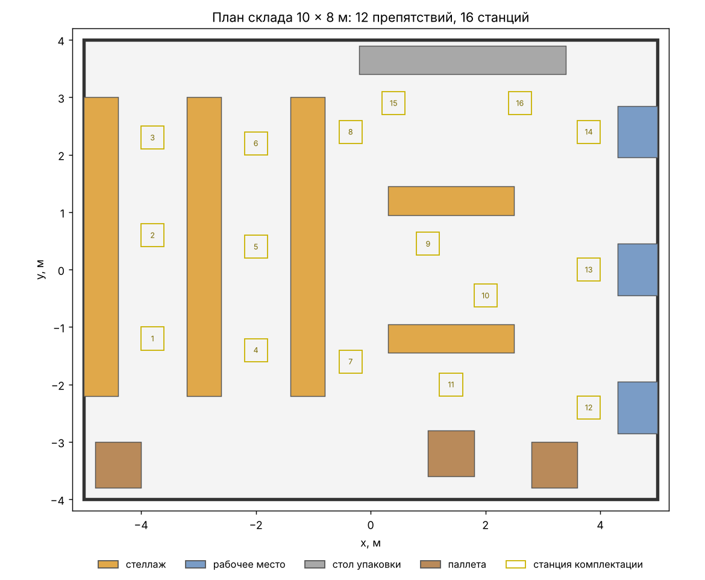
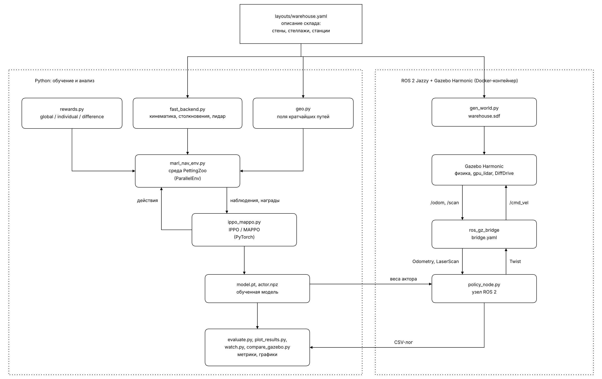
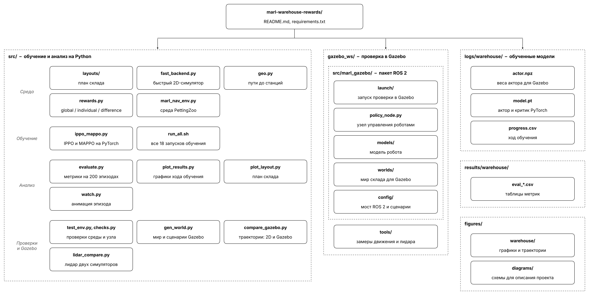

# Методы вознаграждения для распределения вклада в мультиагентной навигации роботов на складе

Код к отчёту по технологической практике. Автор: Волов Г. А.

Три робота обслуживают заказы на станциях склада 10 × 8 м. Сравниваются три способа
формирования вознаграждения: **global**, **individual** и **difference** для алгоритмов
**IPPO** и **MAPPO**. Обучение идёт в быстром 2D-симуляторе, проверка уже обученной модели
в Gazebo Harmonic через ROS 2 Jazzy.



*План склада: 12 препятствий, 16 станций*

## Как устроена задача

На складе 16 станций комплектации. В начале эпизода заказы приходят на 3 случайные станции,
не ближе 1,2 м друг к другу, а 3 робота появляются в случайных свободных точках. Эпизод успешен,
если у каждой станции с заказом одновременно стоит свой робот не дальше 0,3 м от её центра.
На эпизод отводится 40 с. Сам робот видит 37 чисел: свою скорость, направление и длину пути
до каждой станции в обход стеллажей, положение соседей и 16 лучей лидара. Всего действий 7:
стоп, вперёд медленно, вперёд быстро, а также плавные повороты и развороты на месте.

Роботами управляет одна общая нейросеть-актор. При обучении ей помогает критик: в IPPO он
видит только своего робота, а в MAPPO весь склад. Способ награды определяет, за что хвалят
каждого робота:
- **global**: все получают общую награду группы;
- **individual**: каждый получает награду за своё приближение к ближайшей станции;
- **difference**: каждый получает разницу между наградой группы с ним и без него.

## Архитектура



Проект состоит из двух частей, и обе строятся по одному плану склада `layouts/warehouse.yaml`.

**Слева:** обучение и анализ на Python.
- `fast_backend.py` двигает роботов, проверяет столкновения и считает лидар;
- `geo.py` заранее считает длины путей до станций в обход стеллажей;
- `rewards.py` начисляет награды global, individual или difference;
- `marl_nav_env.py` собирает всё это в мультиагентную среду PettingZoo;
- `ippo_mappo.py` обучает нейросети: получает от среды наблюдения и награды, возвращает действия и в конце сохраняет модель в `model.pt` и `actor.npz`;
- `evaluate.py`, `plot_results.py`, `watch.py` и `compare_gazebo.py` считают метрики, рисуют графики и анимацию.

**Справа:** проверка в Gazebo внутри Docker-контейнера.
- `gen_world.py` строит из плана мир `warehouse.sdf`;
- Gazebo моделирует физику движения, лидар и дифференциальный привод;
- `ros_gz_bridge` передаёт одометрию и лидар в ROS 2 и возвращает команды скорости;
- `policy_node.py` по весам из `actor.npz` выбирает действия роботов и записывает траектории в CSV, по которым их потом сравнивают с быстрым симулятором.

## Структура репозитория



- **src/**: среда, обучение, оценка и графики на Python.
- **gazebo_ws/**: пакет ROS 2 для проверки обученных роботов в Gazebo.
- **logs/warehouse/**: обученные модели всех шести вариантов.
- **results/**: таблицы метрик.
- **figures/**: графики и траектории в `warehouse/`, схемы для описания проекта в `diagrams/`.

## Требования к программному обеспечению

| Программа | Версия | Для чего нужна |
|---|---|---|
| Ubuntu (WSL 2) | 24.04 | операционная система |
| Python | 3.12 | основной язык разработки |
| PyTorch | 2.15 | нейросети и их обучение |
| PettingZoo / Gymnasium | 1.27 / 1.4 | интерфейс мультиагентной среды |
| NumPy | 2.5 | вычисления в быстром симуляторе и при управлении роботами в Gazebo |
| pandas | 3.1 | обработка результатов |
| Matplotlib | 3.11 | графики и траектории |
| PyYAML | 6.0 | чтение планов склада и сценариев |
| Docker | 29.1 | контейнер с ROS 2 и Gazebo |
| ROS 2 | Jazzy | обмен данными между Gazebo и узлом управления |
| Gazebo | Harmonic | проверка обученных роботов в симуляции |

## Просмотр обученных роботов

```bash
git clone https://github.com/1Luffiz/marl-warehouse-rewards.git
cd marl-warehouse-rewards
pip install -r requirements.txt
cd src
python watch.py                              # MAPPO + difference
python watch.py --run mappo_individual_s0    # награда individual
python watch.py --run random
python watch.py --frames 4
```

## Обучение и оценка

```bash
cd src
python ippo_mappo.py --algo mappo --reward difference --seed 1 --steps 1200000   # один запуск обучения
bash run_all.sh                                                   # все 18 запусков обучения параллельно
python evaluate.py                                                # метрики на 200 тестовых эпизодах
python plot_results.py                                            # графики хода обучения
```

В репозитории лежат модели только для seed 0, поэтому `evaluate.py` без полного обучения
посчитает метрики по одному seed. Итог по трём seed из отчёта хранится в `results/warehouse/eval_3seeds.csv`.

## Проверка в Gazebo через Docker

**1. Запуск контейнера**

Linux:
```bash
xhost +local:docker
docker run -it --rm --name marl --net=host \
  -e DISPLAY=$DISPLAY -v /tmp/.X11-unix:/tmp/.X11-unix \
  -v ~/marl-warehouse-rewards:/ws osrf/ros:jazzy-desktop-full bash
```

Windows:
```bash
docker run -it --rm --name marl --net=host -e DISPLAY=$DISPLAY -e WAYLAND_DISPLAY=$WAYLAND_DISPLAY -e XDG_RUNTIME_DIR=$XDG_RUNTIME_DIR -v /tmp/.X11-unix:/tmp/.X11-unix -v /mnt/wslg:/mnt/wslg -v ~/marl-warehouse-rewards:/ws osrf/ros:jazzy-desktop-full bash
```

**2. Сборка пакета и запуск сценария**
```bash
cd /ws/gazebo_ws && colcon build && source install/setup.bash
ros2 launch marl_gazebo marl_3robots.launch.py world:=warehouse scenario:=1 \
    policy:=true model:=/ws/logs/warehouse/mappo_difference_s0/actor.npz
```

Номер сценария задаётся параметром `scenario`: 0, 1 или 2. Другую обученную модель можно
выбрать, указав в `model` путь к её `actor.npz` из `logs/warehouse/`.

**3. Сравнение с быстрым симулятором.** Узел записывает траектории в `logs/gazebo/`.
```bash
cd src
python compare_gazebo.py
```

## Итоговые результаты

В таблицах среднее по трём seed, у каждой модели 200 тестовых эпизодов.

IPPO:

| Награда | Успех, % | Скопление у одной станции, % |
|---|---|---|
| global | 49,0 | 6,3 |
| individual | 13,0 | 81,7 |
| difference | 53,3 | 9,2 |

MAPPO:

| Награда | Успех, % | Скопление у одной станции, % |
|---|---|---|
| global | 48,0 | 6,5 |
| individual | 12,8 | 77,2 |
| difference | 53,3 | 10,2 |

Способ награды влияет на результат намного сильнее, чем выбор алгоритма. Лучше всего задачу
решает награда difference: около 53 % успешных эпизодов у обоих алгоритмов. Награда global
отстаёт примерно на 4,5 %, зато роботы с ней реже съезжаются к одной станции. С наградой individual
каждый робот думает только о себе и едет к ближайшей станции, поэтому примерно в 79 % эпизодов двое
и больше оказываются у одной станции, а успешных эпизодов всего около 13 %.

MAPPO в этой задаче не дал преимущества перед IPPO: при одинаковой награде доля успехов почти
совпадает. При этом у MAPPO заметно больше разброс между запусками с разными seed: с наградой global
доля успехов по трём seed от 40,5 до 54,0 %. Получается, что для распределения роботов по станциям важнее правильно
посчитать вклад каждого робота в награду, чем дать критику видеть весь склад.
